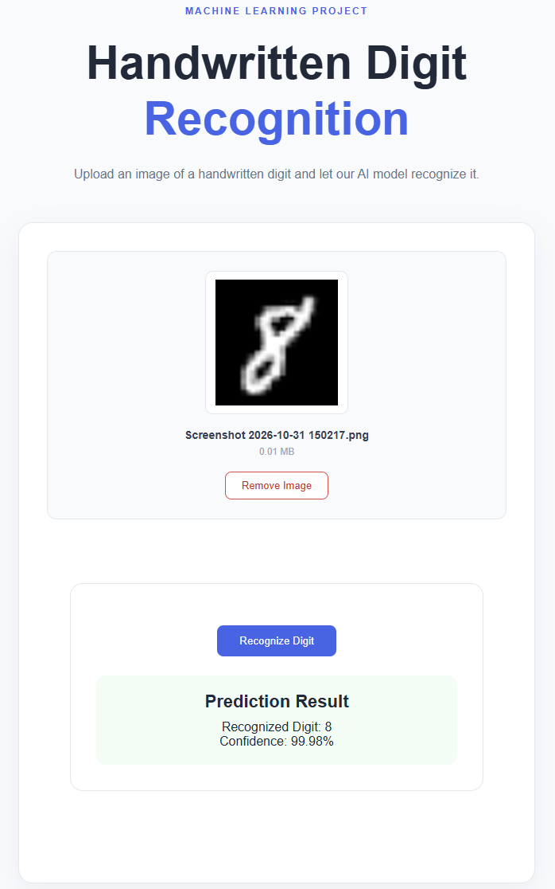

# Digit Recognition Platform


## Application Preview



A full-stack machine learning application for recognizing handwritten digits (0–9) using a trained PyTorch model.

This project focuses on integrating machine learning into a practical web application through a modular architecture, REST APIs, frontend development, automated testing, and containerization.

## Features

- **Handwritten Digit Recognition:** Predicts digits from 0 to 9 using a trained neural network.
- **Image Upload:** Upload and preview handwritten digit images through an interactive interface.
- **Image Preprocessing:** Converts images to grayscale, resizes them to 28×28 pixels, and prepares them for model inference.
- **Prediction Results:** Displays the recognized digit and model confidence score.
- **Input Validation:** Handles unsupported formats, invalid images, and oversized uploads.
- **Error Handling:** Provides centralized backend error handling and service communication management.
- **End-to-End Integration:** Connects the frontend, backend, and ML service through independent Docker containers.

## Architecture

The application consists of three independent services:

| Service | Technologies | Responsibility |
|---|---|---|
| Frontend | React, TypeScript, Vite | User interface and image uploads |
| Backend | Node.js, Express, TypeScript | API management and ML service integration |
| ML Service | Python, PyTorch, FastAPI | Image preprocessing and model inference |

**Communication Flow:**

```text
User
  |
  v
React Frontend + Nginx
  |
  v
Node.js / Express Backend
  |
  v
FastAPI ML Service
  |
  v
PyTorch Model (MNIST)
```

Docker Compose orchestrates all three services through an internal network. Nginx serves the frontend and acts as a reverse proxy for API requests.

## Technology Stack

- **Languages:** Python, TypeScript, JavaScript
- **Machine Learning:** PyTorch, Torchvision, MNIST
- **Image Processing:** Pillow (PIL)
- **Backend:** Node.js, Express.js
- **ML API:** FastAPI, Uvicorn
- **Frontend:** React, React Router, Vite
- **Styling:** CSS Modules
- **Infrastructure:** Docker, Docker Compose, Nginx
- **Testing & CI/CD:** Pytest, automated tests, GitHub Actions
- **Version Control:** Git, GitHub

## Engineering Practices

- Modular architecture and separation of concerns.
- RESTful API design and integration across different programming languages.
- Type-safe development using TypeScript and strict compiler settings.
- Input validation, centralized error handling, and CORS configuration.
- Environment-based configuration and service communication.
- Automated testing and CI workflows.
- Multi-stage Docker builds and container orchestration.
- Git branching, focused commits, and pull-request-based development.

## Running with Docker

**Prerequisites:** Docker Desktop and Docker Compose.

Clone the repository:

```bash
git clone https://github.com/niusha-yaghini/digit-recognition-platform.git
cd digit-recognition-platform
```

Build and start all services:

```bash
docker compose up --build -d
```

Open the application:

```text
http://localhost:5173
```

Useful commands:

```bash
docker compose ps
docker compose logs -f
docker compose down
```

## Project Outcomes

- Developed and evaluated a handwritten digit classification model.
- Integrated a PyTorch model into a dedicated FastAPI service.
- Connected Python-based ML functionality to a Node.js backend.
- Built an interactive React frontend for image-based predictions.
- Containerized and integrated all services using Docker Compose.
- Successfully tested real image uploads and end-to-end predictions in the Docker environment.

**Status:** Core application implemented, Docker integration completed and tested.

## License

To be determined.